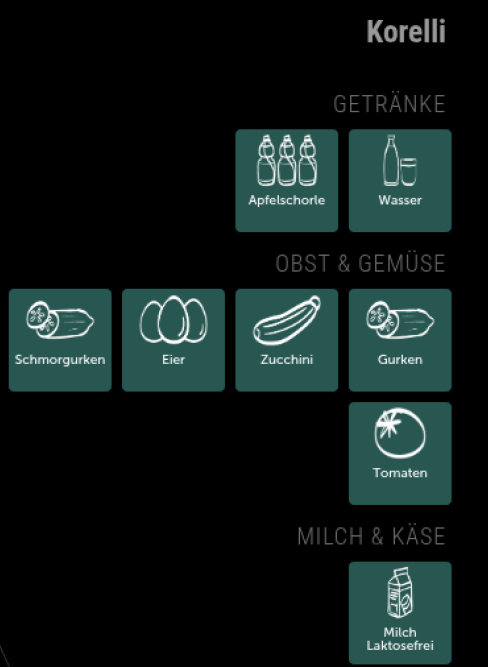
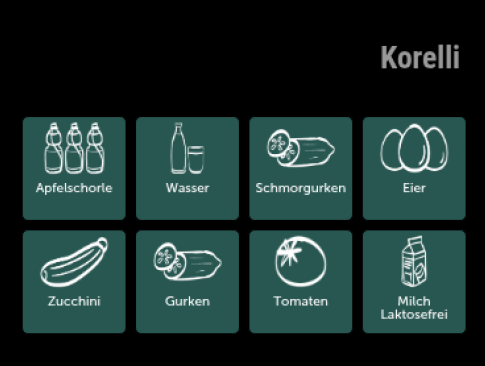
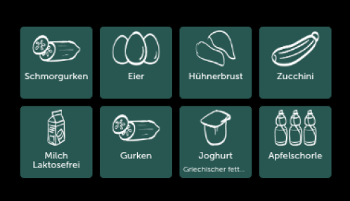

# MMM-Bring

A module for [MagicMirror²](https://github.com/MagicMirrorOrg/MagicMirror) that displays your
[Bring!](https://www.getbring.com) shopping list — optionally **grouped by category and sorted exactly like the
Bring! app** (section order, hidden sections and language are taken from your list settings).

**How this module talks to Bring!** Bring! offers no public API. Like the original module by David Werth, of
which this is a fork, MMM-Bring uses the interfaces of Bring!'s web app (web.getbring.com) — a web app that has
been left in beta and unmaintained for years and may disappear at any time. Other projects work the same way,
e.g. the Python library [miaucl/bring-api](https://github.com/miaucl/bring-api), on which Home Assistant's
built-in [Bring! integration](https://www.home-assistant.io/integrations/bring) is based.

### The three `useSections` modes

| `"show"` — grouped with category headers | `"on"` — sorted into category order, no headers | `"off"` — raw list order |
|:---:|:---:|:---:|
|  |  |  |
| Items grouped into Bring! sections with a header per category, exactly like the app. | Items sorted into the app's category order as one continuous list — no headers, no extra breaks. | The plain list in the raw order the API returns it. |

## What's new in 3.0.0
* **Local catalog (optional)** — make your mirror show articles, categories and icons just like the Bring! app.
  See [Local catalog](#local-catalog-optional). No breaking changes: without it, everything works as before.

## What's new in 2.0.0
* **App-identical categories** — items are grouped into the same sections the Bring! app uses, ordered by your
  list's own `listSectionOrder`, honouring hidden sections; items with no category go into an *own items* section
  whose label is localized per `locale`.
* **Zero runtime dependencies** — `axios` and `data-store` removed; uses native `fetch` (Node ≥ 18).
* **Backend-driven polling** — the node helper owns the refresh cycle and caches the last good state, so a browser
  reload shows data instantly and a transient network error never blanks the list.
* **Modern auth** — access token is refreshed via `refresh_token`, with a password re-login only as fallback.

The full list of changes (including bug fixes and the security/QA pass) is in [CHANGELOG.md](CHANGELOG.md).

## Features
* Category grouping / sorting (`useSections`)
* Touch support (mark bought, add via MMM-Keyboard)
* Locale support
* Auto-layout
* Optional [local catalog](#local-catalog-optional) — articles, categories and icons just like the app

## Installing
```bash
cd ~/MagicMirror/modules
git clone https://github.com/rkorell/MMM-Bring.git
```
No `npm install` needed — the module has **zero runtime dependencies**. Just add the module block to your
`config.js` (see [Configuration](#configuration)).

## Updating
```bash
cd ~/MagicMirror/modules/MMM-Bring
git pull
```

## Migrating from the original module
If you already run David Werth's original `MMM-Bring` and want to switch to this fork, the simplest way is to
replace the folder — your `config.js` entry stays the same:
```bash
cd ~/MagicMirror/modules
rm -rf MMM-Bring
git clone https://github.com/rkorell/MMM-Bring.git
```
Alternatively, if you are comfortable with git, just repoint the remote (the fork shares the original's history,
so this fast-forwards):
```bash
cd ~/MagicMirror/modules/MMM-Bring
git remote set-url origin https://github.com/rkorell/MMM-Bring.git
git pull
```
The first refresh logs in again automatically (the local token cache is rebuilt).

## Configuration
```json5
{
    module: "MMM-Bring",
    position: "top_right",
    config: {
        email: "USER@EXAMPLE.COM",
        password: "SECRET",
        updateInterval: 15,       // minutes
        listName: "Home",         // optional; default = your default list
        showListName: true,
        showCount: true,          // show a count when the list is longer than maxItems
        useSections: "on",        // "off" | "on" | "show"
        activeItemColor: "#EE524F",
        latestItemColor: "#4FABA2",
        showLatestItems: false,
        maxItems: 0,
        maxLatestItems: 0,
        locale: "de-DE",
        useKeyboard: false,
        customTitle: "My shopping list", // optional
        listDropdown: true
    }
}
```

| Option            | Description |
|-------------------|-------------|
| `email`           | *Required.* Bring! account email. |
| `password`        | *Required.* Bring! account password. |
| `updateInterval`  | How often the list is reloaded. **Type:** `number` (minutes) **Default:** `15` |
| `listName`        | Name of the list to display. **Type:** `string` **Default:** your default list |
| `showListName`    | Show the list name as title. **Type:** `boolean` **Default:** `true` |
| `showCount`       | When the purchase list is longer than `maxItems`, show a count. Appended to the title as ` (total)` (e.g. `Home (11)`); if there is no title (`showListName: false` and no `customTitle`) it is shown alone as `...[maxItems/total]` (e.g. `...[8/11]`). Never shown when `maxItems: 0`. **Type:** `boolean` **Default:** `true` |
| `useSections`     | Category handling. **`"off"`** = flat list in raw order. **`"on"`** = items *sorted* into the app's section order as one continuous list, **without** headers. **`"show"`** = additionally render the category name as a header. **Type:** `string` **Default:** `"on"` |
| `activeItemColor` | Colour for items to buy. **Type:** `string` **Default:** `#EE524F`  |
| `latestItemColor` | Colour for recently bought items. **Type:** `string` **Default:** `#4FABA2`  |
| `showLatestItems` | Show recently bought items. **Type:** `boolean` **Default:** `false` |
| `maxItems`        | Max items to display. **Type:** `number` **Default:** `0` (all) |
| `maxLatestItems`  | Max recent items to display. **Type:** `number` **Default:** `0` (all) |
| `locale`          | Fallback language if the list has no `listArticleLanguage`. **Type:** `string` **Default:** `de-DE` |
| `useKeyboard`     | Use together with MMM-Keyboard to add items. **Type:** `boolean` **Default:** `false` |
| `customTitle`     | Show this text as the module title (above the list name). When set, the `showCount` count is appended here instead of to the list name. **Type:** `string` **Default:** `undefined` |
| `listDropdown`    | With more than one list, show a dropdown selector. **Type:** `boolean` **Default:** `true` |

### Valid locales
`de-AT`, `de-CH`, `de-DE`, `es-ES`, `en-GB`, `en-US`, `en-CA`, `en-AU`, `fr-CH`, `fr-FR`, `it-CH`, `it-IT`,
`pt-BR`, `nl-NL`, `hu-HU`, `nb-NO`, `pl-PL`, `ru-RU`, `sv-SE`, `tr-TR`

## Local catalog (optional)
As mentioned above, this module talks to Bring!'s web app — and that one hasn't seen any love for years. Its
article catalog is just as old. That's why newer articles end up as *own items* with a plain letter, while the
app shows them with a nice icon in the right category. Annoying! :-)

The good news: the Bring! app on your phone carries the current catalog with it. A small script pulls it out of
your own app package and hands it to the module — and your mirror looks just like the app. Don't feel like it?
No problem: without a local catalog, everything stays as it is.

**Your responsibility.** Getting the app package, running the script and using the data is entirely your call
and at your own risk. The catalog, names and icons belong to Bring! Labs AG. I share the script as is — no
warranty, no liability.

Step by step to your local catalog: [tools/README.md](tools/README.md)

## Notes
* **Localization.** Category and item names are shown in your list's language, as set in the Bring! app. If the
  list has none, the module's `locale` config option is used. The names come from Bring!'s web catalog, or from
  your [local catalog](#local-catalog-optional) if you built one. The label of the *own items* section comes from
  the module's own `translations/` files, also selected by the `locale` config option.
* **Font.** The item name uses *Museo Sans 500* by Jos Buivenga / [exljbris](https://www.exljbris.com/museosans.html)
  (free weight; attribution as required by its licence). The specification label uses *Roboto Condensed* (the
  MagicMirror default font).

## Credits
* Original module: **David Werth** — <https://github.com/werthdavid/MMM-Bring>
* Fork & 2.0.0 rewrite: **Dr. Ralf Korell** — <https://github.com/rkorell/MMM-Bring>
* API interaction inspired by [miaucl/bring-api](https://github.com/miaucl/bring-api) (Python) as a reference for a current, state-of-the-art Bring! implementation.

## License
[MIT](LICENSE) — see the [LICENSE](LICENSE) file for the full text. The bundled font ("Museo Sans" by Jos Buivenga / exljbris) is covered by a separate free-font licence; see the [NOTICE](NOTICE) file for the required attribution.
